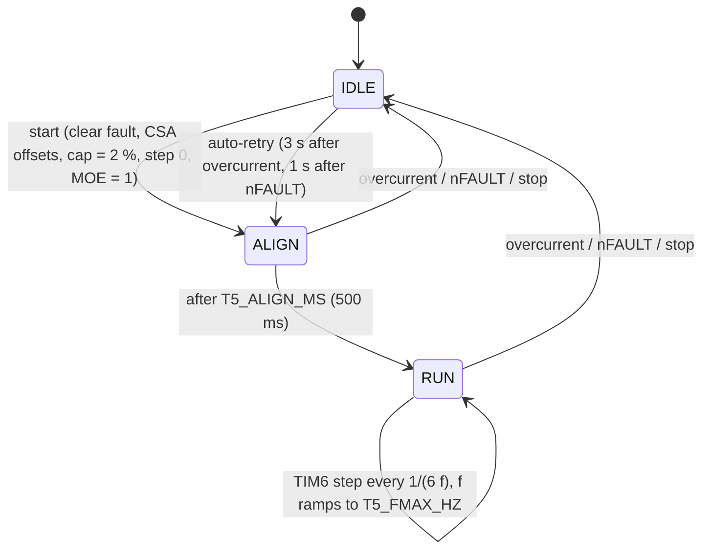

# Trapezoidal (6-step) commutation

Six-step, or trapezoidal, commutation is the drive that is **verified end to end
on this board**. It ran the 12N14P drone motor to 200 Hz electrical (1714 rpm)
on 9 V, both in the bring-up firmware (2026-11-17) and in this repository
(2026-11-18). This document explains how it works, how it is implemented here,
why it is the drive that works with the DRV8316 as strapped, what was
measured, and how to tune and debug it.

Implementations:

| Where | Commutation timing | Use |
|---|---|---|
| [`firmware/tests/test_05_open_loop/main.c`](../firmware/tests/test_05_open_loop/main.c) | TIM6 interrupt, 10 µs resolution | Stand-alone autostart test, current limiter, trip and auto-retry |
| [`firmware/tests/test_08_drive_lab/main.c`](../firmware/tests/test_08_drive_lab/main.c) (`mode 6step`) | Angle accumulator in the 20 kHz ADC interrupt, 50 µs resolution | Side-by-side comparison with sine, SVPWM and DPWM, per-phase current statistics |

Related documents: [`hardware.md`](hardware.md) (DRV8316 straps),
[`control.md`](control.md#modulation) (why sine/SVPWM fail on this board),
[`results/2026-11-18_drive_lab.md`](results/2026-11-18_drive_lab.md) (lab
results for all modulations).

---

## 1. Principle

A three-phase BLDC motor has three windings, A, B and C, joined at a star
point. In six-step drive, **two phases conduct at any time and the third is
left open**:

- one phase is driven high with PWM, so current flows **into** the motor (`+`);
- one phase is held low, so current flows back **out** to ground (`−`);
- the third phase is disconnected (Hi-Z).

That gives six possible combinations per electrical revolution, 60° apart.
Stepping through them in order rotates the stator field in 60° jumps, and the
rotor magnets follow. One electrical revolution = 6 steps. One mechanical
revolution = `pole_pairs` electrical revolutions:

```
steps per second  = 6 * f_e
mechanical rpm    = 60 * f_e / pole_pairs        (7 pole pairs for a 12N14P motor)
step period       = 1 / (6 * f_e)                (200 Hz -> 833 us per step)
```

The PWM duty on the `+` phase sets the average voltage across the conducting
pair, `V_pair ≈ duty * VIN`. The phase current is set by that voltage minus the
motor's back-EMF, over the resistance of two windings in series:

```
I_phase ≈ (duty * VIN - E_pair) / (2 * R_phase)
```

At standstill `E_pair = 0` and only the winding resistance limits the current.
For this motor R ≈ 0.138 Ω per phase (measured, see the lab results), so 1 %
duty on 9 V is already about 0.3 A. That is why every implementation here has
a current limiter, and why the duty starts at 2 %.

### Why the current is called "trapezoidal"

Each phase conducts for 120° (two steps) positive, is open for 60°, conducts
for 120° negative, and is open for 60°. With a trapezoidal back-EMF motor the
phase current is a flat-topped block that lines up with the flat part of the
back-EMF. With a sinusoidal-EMF motor (most small outrunners) it still works,
with more torque ripple than sinusoidal drive.

---

## 2. Why six-step is the drive that works on this board

The DRV8316 is strapped with **OCP/SR (pin 35) floating**, which enables
ASR/AAR active demagnetisation. Measured consequence: **current flows only
while at least one phase's low side is held on with no PWM edges**. When all
three phases switch, the bridge passes almost nothing:

| Fixed duties A / B / C | Phase held at 0 %? | Measured current (stalled motor, 9 V) |
|---|---|---|
| 10 / 0 / 0 | yes, B and C | A +3.21 A, B −1.63 A, C −1.52 A |
| 12 / 0 / 6 | yes, B | A +3.07 A, B −3.05 A |
| 26 / 14 / 20 | no | 0 A |
| 56 / 44 / 50 | no | 0 A |

Six-step always has exactly one phase held low continuously (the `−` phase)
and only one phase switching, so it is never in the blocked case. Sine and
SVPWM switch all three phases and produced 0.01 A in the same run. See
[`control.md`](control.md#modulation) for the full analysis and the proposed
fix (pin 35 to GND).

---

## 3. Board mapping

The phases are wired to TIM1 in reverse order. Every implementation keeps a
`phase -> channel` table instead of assuming A = CH1:

| Phase | High side (INHx) | Low side (INLx) | Timer channel | Current sense |
|---|---|---|---|---|
| A | PA10 | PB15 (**AF4**, not AF6) | TIM1_CH3 / CH3N | SOA → PA0 → ADC1_IN1 |
| B | PA9 | PB14 | TIM1_CH2 / CH2N | SOB → PA1 → ADC1_IN2 |
| C | PA8 | PB13 | TIM1_CH1 / CH1N | SOC → PA2 → ADC1_IN3 |

```c
static const uint8_t k_phase_ch[3] = { 3u, 2u, 1u };   /* A = CH3, B = CH2, C = CH1 */
```

The DRV8316 is in **6x PWM mode** (MODE pin 33 to GND), so each FET has its own
input. Truth table per phase:

| INH | INL | Phase output |
|---|---|---|
| 0 | 0 | Hi-Z |
| 1 | 0 | High (VM) |
| 0 | 1 | Low (GND) |
| 1 | 1 | Hi-Z |

The driver inserts **no dead time** in 6x mode. TIM1 inserts 1.0 µs
(`PWM_DEADTIME = 0x80 | 21` = 170 ticks at 170 MHz), matching the 125 V/µs
SLEW strap.

---

## 4. The step table

Each phase is in one of three states per step:

| Code | Meaning | TIM1 setting | Gate pins | Bridge |
|---|---|---|---|---|
| **P** | PWM high side | OCxM = PWM mode 1 (6), CCxE = CCxNE = 1 | INH = PWM, INL = complement with 1 µs dead time | High side PWM, low side synchronous rectification |
| **L** | Held low | OCxM = force inactive (4), CCxE = CCxNE = 1 | INH = 0, INL = 1 continuously | Low side on all period, no edges |
| **Z** | Open | CCxE = CCxNE = 0 | Not driven; GPIO pull-downs give INH = INL = 0 | Hi-Z |

The sequence, `{A, B, C}`:

| Step | A | B | C | Current path | Stator vector |
|---|---|---|---|---|---|
| 0 | P | L | Z | A → B | −30° |
| 1 | P | Z | L | A → C | +30° |
| 2 | Z | P | L | B → C | +90° |
| 3 | L | P | Z | B → A | +150° |
| 4 | L | Z | P | C → A | +210° |
| 5 | Z | L | P | C → B | +270° |

```c
/* {A, B, C}. Forward = step + 1. */
static const uint8_t k_steps[6][3] = {
    { P, L, Z },    /* 0  A+ B- */
    { P, Z, L },    /* 1  A+ C- */
    { Z, P, L },    /* 2  B+ C- */
    { L, P, Z },    /* 3  B+ A- */
    { L, Z, P },    /* 4  C+ A- */
    { Z, L, P },    /* 5  C+ B- */
};
```

Forward rotation is `step + 1`, reverse is `step − 1`. Each phase follows the
pattern `P P Z L L Z`, shifted by two steps between phases.

Phase-voltage pattern over one electrical revolution:

```
step:      0     1     2     3     4     5     0
         +-----+-----+     .     .-----+-----+
phase A  | PWM | PWM |  Z  | LOW | LOW |  Z  | PWM ...
         .     +-----+-----+-----+     .
phase B  | LOW |  Z  | PWM | PWM |  Z  | LOW |
         .     .     +-----+-----+-----+
phase C  |  Z  | LOW | LOW |  Z  | PWM | PWM |
```

### Verified gate behaviour

Bring-up firmware, no motor, 12 V, 20 % duty, 20 Hz. Percentage of time each
gate pin was high, read back from GPIO IDR:

| Step | INHA | INLA | INHB | INLB | INHC | INLC |
|---|---|---|---|---|---|---|
| 0 A+B− | 17 | 79 | 0 | 100 | 0 | 0 |
| 1 A+C− | 17 | 79 | 0 | 0 | 0 | 100 |
| 2 B+C− | 0 | 0 | 17 | 79 | 0 | 100 |
| 3 B+A− | 0 | 100 | 17 | 79 | 0 | 0 |
| 4 C+A− | 0 | 100 | 0 | 0 | 17 | 79 |
| 5 C+B− | 0 | 0 | 0 | 100 | 17 | 79 |

The PWM phase reads 17 % / 79 % instead of 20 % / 80 % because of the two
1 µs dead times per 50 µs period.

---

## 5. Current paths

**PWM on** (high side of the P phase on):

```
VM ─► HS(P) ─► winding P ─► star ─► winding L ─► LS(L) ─► GND
```

**PWM off** (dead time, then low side of the P phase on, synchronous
rectification):

```
LS(P) ─► winding P ─► star ─► winding L ─► LS(L) ─► GND ─► LS(P)   (freewheel loop)
```

The L phase's low-side FET carries the full winding current **in both
halves of the PWM period**. That is what makes current sensing simple (next
section), and it is also why the supply current is much smaller than the phase
current: the supply only delivers current during the on-time.

```
I_supply ≈ duty * I_phase           e.g. 24 % * 1.8 A ≈ 0.43 A at 200 Hz
```

A PSU reading of 0.3–0.5 A while the firmware reports 2 A is normal.

---

## 6. Timer mechanics: atomic commutation

A commutation changes up to three phases at once (for example step 0 → 1:
B goes L → Z and C goes Z → L). If those changes landed on different clock
edges, two phases could briefly both be L, or the wrong pair could conduct.
TIM1's **commutation preload** makes the change atomic:

1. `TIM1->CR2 |= TIM_CR2_CCPC`: CCxE, CCxNE and OCxM become preloaded.
2. `load_step(s)` writes the new OCxM and CCER bits for all three phases.
   Nothing changes on the pins yet.
3. `TIM1->EGR = TIM_EGR_COMG` generates a commutation event. All preloaded
   bits transfer on the same timer clock.

```c
static void load_step(uint8_t s)
{
    uint32_t ccer = TIM1->CCER & ~(CC1E | CC1NE | CC2E | CC2NE | CC3E | CC3NE);

    for (uint32_t p = 0u; p < 3u; p++)
    {
        uint32_t ch = k_phase_ch[p];
        uint32_t en = (1u << (4u * (ch - 1u))) | (1u << (4u * (ch - 1u) + 2u));

        switch (k_steps[s][p])
        {
        case P:  set_ocm(ch, OCM_PWM1);      ccer |= en; break;
        case L:  set_ocm(ch, OCM_FORCE_LOW); ccer |= en; break;
        default: break;                                  /* Z: off */
        }
    }
    TIM1->CCER = ccer;
    TIM1->EGR  = TIM_EGR_COMG;
}
```

`set_ocm()` writes the 3-bit OCxM field (bits 6:4 for odd channels, 14:12 for
even ones, in CCMR1 or CCMR2) and clears the 4th mode bit. It never touches
channel 4, which is the ADC trigger.

Other TIM1 settings: centre-aligned mode 1, ARR = 4249 (20 kHz at 170 MHz), CCR
preload on, OSSR = OSSI = 1, MOE = 0 until the bridge is started. All three
CCRs get the same value (`duty * (ARR + 1)`); only the P phase uses it.

### Commutation timer

`test_05` uses TIM6 as a step clock:

```
TIM6 tick      = 100 kHz (10 us)
TIM6 ARR       = 100000 / (6 * f_e) - 1     (preloaded: applies from the next step)
TIM6 interrupt = one step: s = (s + 1) % 6, load_step(s)
```

The resolution is 10 µs on an 833 µs step at 200 Hz, about 1 %. The lowest
frequency is about 0.25 Hz (ARR limit 65535).

`test_08_drive_lab` instead integrates an electrical angle in the 20 kHz ADC
interrupt and changes step when `floor(theta / 60°)` changes. That is simpler
to share with the sinusoidal modes but has 50 µs resolution (6 % of a step at
200 Hz).

---

## 7. Current sensing in six-step

The DRV8316 current-sense amplifiers measure **low-side** current, so SOx is
valid only while that phase's low side is on. In six-step:

- the **L phase** low side is on all period → its SOx always shows the full
  winding current;
- the **P phase** low side is on during PWM-off → valid at the counter peak;
- the **Z phase** carries no current.

The ADC is triggered by TIM1 OC4REF at the counter peak (`CCR4 = ARR − 1`),
converts SOA/SOB/SOC with DMA at 20 kHz, and the DMA-complete callback takes
the L phase:

```c
i = fabsf(((float)adc[lp] - offset[lp]) * (3.3f / 4095.0f) / 0.3f);   /* A */
i_filt += 0.01f * (i - i_filt);                                       /* tau 5 ms */
```

| Item | Value |
|---|---|
| CSA gain | 0.3 V/A (GAIN pin open) |
| Zero-current offset | 1.64–1.65 V (measured), recalibrated with the bridge off before every start |
| Valid offset window | 1.3–2.0 V; outside it the CSA is "not usable" and duty is capped at 8 % |
| Resolution | 2.686 mA per ADC count |
| Measurable range | about ±5.4 A (ADC saturation) |
| Sign | SOx rises for current out of the phase into the motor; the L phase reads negative, hence `fabsf` |

Sampling at a fixed point in the PWM period (rather than once per millisecond,
as the bring-up firmware did) catches commutation spikes the old method
missed. That is why peak readings reach the 5.5 A ADC ceiling at high speed
while the filtered current stays at the 2 A limit.

---

## 8. Control: duty, current limiter, protection

Everything below runs at 1 kHz, from every 20th ADC interrupt (20 kHz → 1 kHz).

### Duty slew

The target duty (`T5_DUTY_PCT`, 40 %) is approached at 0.05 %/ms (5 % per
100 ms). The target is a ceiling, not the operating point: the limiter
decides the real duty.

### Current limiter

A duty cap that follows the measured current:

```
if i_filt > ilim:   cap = min(applied, cap) - 0.1 %/ms     (fast down)
else:               cap = min(cap + 0.02 %/ms, applied + 2 %)   (slow up, no wind-up)
applied duty = min(slewed target, cap)
```

- The cap starts at 2 % on every start, so alignment can't overcurrent.
- The cap can never run more than 2 % above the applied duty. Without that,
  it wound up during alignment in the bring-up firmware and tripped.

### Trips and retries

| Condition | Response | Retry |
|---|---|---|
| `i_filt > min(2 * ilim, 5.3 A)` for 20 ms | Stop | after 3 s |
| nFAULT low for 2 consecutive ms | Stop | after 1 s, with a 30 µs nSLEEP fault-clear pulse |
| CSA offset outside 1.3–2.0 V | Run with duty capped at 8 % | — |
| Ctrl-C / ESC on the USB console | Stop for good | power cycle or reflash |

**Stop** means MOE = 0, all CCxE/CCxNE cleared plus COMG, duty 0 and TIM6
stopped. DRVOFF stays **low**: DRVOFF high makes the DRV8316 pull nFAULT low,
so it is not used as an idle state.

---

## 9. Start-up sequence

The board has no Hall sensors and no phase-voltage dividers, so back-EMF zero
crossings can't be detected. Commutation is **forced (open loop)**, like a
stepper motor:



1. **Prepare**: clear any latched fault (30 µs nSLEEP pulse), measure the
   three CSA offsets with the bridge off, reset the limiter.
2. **Align**: hold step 0 for 500 ms. The rotor snaps to the step-0 field, so
   its position is known.
3. **Start**: commutate from `T5_FSTART_HZ` (4 Hz electrical).
4. **Ramp**: `df/dt = T5_ACCEL + T5_ACCEL_PROP * f` = 5 Hz/s + 0.1·f. The
   proportional term accelerates faster as back-EMF builds. From 4 Hz this
   reaches 200 Hz in about 15 s:

   ```
   f(t) = (f0 + a0/a1) * exp(a1 * t) - a0/a1   ->   t(4 -> 200 Hz) = 10 * ln(250 / 54) ≈ 15.3 s
   ```

5. **Hold** at `T5_FMAX_HZ`.

**How to tell the rotor is following.** In open loop nothing measures the
rotor directly, but the current limiter does it indirectly. If the rotor keeps
up, back-EMF grows with speed, so the limiter has to **raise** the duty to hold
the same current. A flat duty at the current limit at every speed means no
back-EMF: the rotor is stalled or vibrating.

---

## 10. Measured results

### Bring-up firmware, drone motor, 9 V, 2 A limit (2026-11-17)

| f electrical | Applied duty | Phase current avg / peak |
|---|---|---|
| 15 Hz | 6 % | 0.8 / 1.2 A |
| 60 Hz | 9.7 % | 0.9 / 2.1 A |
| 100 Hz | 14.5 % | 1.7 / 2.7 A |
| 200 Hz | 24 % | 1.7 / 2.9 A |

Rough at 15–60 Hz, smooth at high speed.

### `test_05_open_loop`, 12N14P motor, 9 V, 2 A limit (2026-11-18)

| t (s) | f electrical | rpm | steps/s | Duty | I filtered (peak) |
|---|---|---|---|---|---|
| 1.5 | 6.8 Hz | 58 | 16 | 8.3 % | 2.02 A (2.33) |
| 3.5 | 19.4 Hz | 166 | 96 | 8.5 % | 1.98 A (2.52) |
| 6.5 | 43.7 Hz | 375 | 236 | 9.2 % | 1.96 A (2.88) |
| 8.5 | 64.5 Hz | 553 | 354 | 10.3 % | 0.74 A (3.41) |
| 11.5 | 104.7 Hz | 897 | 585 | 14.4 % | 1.37 A (5.11) |
| 13.5 | 139.0 Hz | 1191 | 782 | 18.5 % | 2.22 A (5.51) |
| 15.5 | 181.0 Hz | 1551 | 1024 | 22.0 % | 1.40 A (5.51) |
| 16.5–24.6 | 200.0 Hz | 1714 | 1205 | 23.4–24.2 % | 1.57–2.38 A (5.51) |

- Duty matches the bring-up firmware: 14.4 % vs 14.5 % at ~100 Hz, 24 % vs
  24 % at 200 Hz.
- 1205 steps/s at 200 Hz against 6 × 200 = 1200 expected.
- Held 200 Hz for 8 s with no fault; stopped from the console.
- Back-EMF check: λ ≈ 0.0009 Wb (measured by `test_08`) predicts a
  line-to-line peak of √3·ω·λ ≈ 1.96 V at 200 Hz; 24 % of 9 V = 2.16 V,
  minus about 0.5 V of resistive drop, fits.

### Same firmware at 6 V: why it faulted

| Run | Result |
|---|---|
| 1 | Duty flat at ~12 % with current at the limit (rotor not following), nFAULT every ~4 s at 22–27 Hz |
| 2 | Rotor followed (duty 12 → 27 %), nFAULT at 139 Hz, peak sample at the 5.5 A ceiling |

The DRV8316 VM undervoltage lockout trips at **4.1–4.3 V falling, with only a
3–7 µs deglitch**. At 6 V, multi-amp current pulses through the PTC, the
reverse-polarity FET and the supply leads, with ~12 µF of bulk capacitance,
dip VM below that. At 9 V the same runs completed. **Run six-step at 9 V or
more**, or add a bulk electrolytic (220–470 µF) across J1 for low-voltage
operation.

### `test_08_drive_lab`, `mode 6step` (2026-11-18)

Same motor, 9 V, 2 A limit, angle-accumulator commutation:

| f electrical | Duty | I filtered | Phase RMS A / B / C | Current flowing |
|---|---|---|---|---|
| 6.8 Hz | 8.2 % | 1.85 A | 1.62 / 1.61 / 1.53 A | 100 % |
| 30.6 Hz | 8.8 % | 1.76 A | 1.55 / 1.58 / 1.55 A | 100 % |
| 58.7 Hz | 9.7 % | 1.97 A | 1.63 / 1.65 / 1.62 A | 100 % |
| 104.3 Hz | 14.3 % | 1.92 A | 1.78 / 1.72 / 1.42 A | 66 % |
| 169.0 Hz | 19.8 % | 2.00 A | 1.82 / 1.82 / 1.76 A | 62 % |

The three phases share the current evenly (RMS within a few percent), which
confirms the step table and phase mapping. Above ~60 Hz the share of samples
with current flowing drops to about 60 %. The likely cause is that at light
load and high back-EMF the current reaches zero within each 60° step (and
after each commutation), but this has not been confirmed with a scope.

---

## 11. Running and tuning

### test_05 (autostart)

```sh
cd firmware
make APP=test_05_open_loop flash          # spins the motor at power-up
```

Every `T5_` macro can be overridden at build time:

| Macro | Default | Effect |
|---|---|---|
| `T5_DUTY_PCT` | 40 % | Duty ceiling; the limiter applies less |
| `T5_ILIM_A` | 2.0 A | Phase current limit (trip at min(2×, 5.3 A)) |
| `T5_FMAX_HZ` | 200 Hz | Final electrical frequency |
| `T5_FSTART_HZ` | 4 Hz | Frequency right after alignment |
| `T5_ACCEL` | 5 Hz/s | Constant part of the ramp |
| `T5_ACCEL_PROP` | 0.1 /s | Proportional part of the ramp |
| `T5_ALIGN_MS` | 500 ms | Alignment time on step 0 |
| `T5_POLE_PAIRS` | 7 | Only for the rpm column |

```sh
make APP=test_05_open_loop USER_DEFS="-DT5_FMAX_HZ=100.0f -DT5_ILIM_A=1.5f" flash
```

The console prints one line per second: time, state, rpm, f, steps/s, duty, I
(peak).

### test_08 (interactive)

```
mode 6step
amp 40          duty ceiling, %
f 200           target electrical Hz
ilim 2          A
accel 5 0.1     ramp
align 500       ms
start / stop
```

or scripted: `python3 tools/lab.py --log ../docs/results/run.log 6step`.

### Tuning guidance

| Goal | Change |
|---|---|
| Motor does not start (twitches, duty flat at the limit) | Longer `align`, lower `fstart` (1–2 Hz), slower `accel`, or more current (`ilim`) if the supply allows |
| Loses sync mid-ramp | Slower `accel` / `accel_prop`, or more current |
| Heavier rotor / load | More `ilim`, slower ramp |
| Higher top speed | Raise `f` and `amp`; needed duty grows about linearly with speed (~24 % at 200 Hz on 9 V) |
| Low-inductance or coreless motor | Current is pulsed, not continuous; the reading at the counter peak may not be the average |

---

## 12. Troubleshooting

| Symptom | Likely cause | Check |
|---|---|---|
| `Start refused: nFAULT low` | VIN missing, or DRVOFF held high | VIN on J1 (TP2/TP3); `test_02_drv8316` |
| `CSA offsets ... NOT USABLE` | DRV asleep or unpowered (SOx reads 0 V) | VIN; `test_04_current_sense` |
| Duty flat at ~8–12 % while current sits at the limit | Rotor not following (stalled/vibrating) | Ramp, alignment, mechanical binding |
| nFAULT after a few seconds at low supply | VM undervoltage (UVLO 4.1–4.3 V) | Use ≥ 9 V, raise the PSU current limit, add bulk capacitance |
| Overcurrent trips at start | Limit too low for the motor, or wrong phase order | `ilim`, motor wiring A/B/C on J2 |
| Runs backwards | Phase order on J2 | Swap two motor wires, or step −1 |
| PSU shows 0.3–0.5 A, firmware 2 A | Normal | Supply current ≈ duty × phase current |
| Peak readings stuck at 5.51 A | ADC saturation on commutation spikes | Normal above ~120 Hz; the filtered current is what is limited |

---

## 13. Limitations and next steps

- **Open loop.** Commutation is forced, not synchronised to the rotor. A load
  step or a too-fast ramp loses sync. The board has no Hall sensors and no
  phase-voltage dividers, so classic sensorless six-step (back-EMF zero
  crossing on the floating phase) is not possible without a rework.
- **Closing the loop**, options in order of effort:
  1. **Sensored six-step with the AS5600**: pick the step from the measured
     electrical angle (`step = floor((theta_e + offset) / 60°)`) instead of a
     timer. The calibration from `test_06_encoder_cal` gives the offset.
  2. **Current-based angle**: the flux observer in `test_08_drive_lab`
     tracked the rotor within 1 Hz at 30–35 Hz during I/f; it could
     time six-step commutation too.
  3. **Phase-voltage dividers** on OUTA/B/C to spare ADC pins (PA3, PB0, PB1,
     PB12 are free) for zero-crossing detection.
- **Torque ripple** from the 60° steps; sinusoidal drive (FOC) would remove it
  but needs pin 35 tied to GND on this board.
- **Current is limited to 2–5 A**: the CSA/ADC saturates at ±5.4 A, the
  DRV8316 is rated 8 A peak, and the copper is good for about 2–3 A
  continuous.
